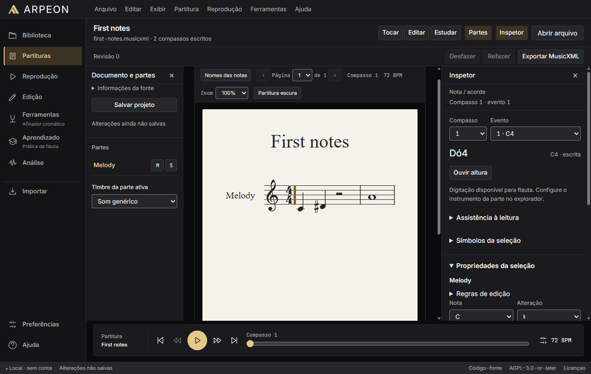

# ARPEON

A local-first music workstation for reading, editing and practising scores. Built
with Java and Angular, with a native desktop window and local audio processing.

[](https://github.com/junior089/ARPEON/actions/workflows/build.yml)
[](LICENSE)
[](docs/releases/0.1.2-windows.md)



## What it does

- **Score editing:** import MusicXML/MXL and supported MSCZ files; edit notes,
  chords, voices and durations; transpose with previews; undo/redo and export
  MusicXML. Originals remain unchanged.
- **Project library:** autosave, named projects, search, duplication and recovery
  through checksums, backups and durable writes. New MusicXML/MXL/MSCZ imports
  retain verified originals and initial-source identities with private original
  download. Unknown editions and unassessed rights remain explicit; legacy
  originals are not reconstructed.
- **Settings:** searchable local preferences for appearance, workspace panels,
  score reading and audio, with category resets and existing update management.
- **Local study profiles:** a local account with up to eight independent libraries,
  preferences, histories and sound banks; profile selection, instruments, editing,
  archive/restore and optional startup in the last profile. Existing local data is
  copied and verified before migration, with originals retained.
- **Playback:** part selection, mute/solo, seek, tempo, metronome, count-in and
  A–B loops, with a synchronized notation cursor and General MIDI instruments.
- **Practice:** flute exercises, scales, arpeggios, long tones and rhythm tasks,
  with pitch measurements, offline fingering guidance and local session history.
- **Tuning and analysis:** a chromatic YIN tuner, fixed-tempo performance reports
  and monophonic score following. Pitch, rhythm, timing and confidence remain
  separate measurements.
- **Reviewed imports:** textual notes, monophonic MIDI/WAV drafts and PDF/image
  recognition through Audiveris. Uncertain rhythm and recognition results require
  review before entering the editor. A bounded Wikimedia MIDI adapter retains
  provenance and declared rights.
- **Desktop maintenance:** Windows executable, per-user MSI, version detection,
  repair, downgrade protection and data preservation. WinSparkle/Ed25519 provides
  the update integration; automatic checks require explicit consent.

Score editing, local imports and audio processing run on this computer. No
remote account, telemetry or audio upload is required. A local account organizes
study profiles on this computer. Microphone capture starts only
on request. Wikimedia imports and configured update checks use the network.

## Architecture and engineering

| Layer | Responsibility |
| --- | --- |
| Java 25 / Gradle | Musical domain, exact score timelines, secure parsers, audio/DSP, MIDI transport, storage and application services |
| Angular 22 / TypeScript | Score workspace, OpenSheetMusicDisplay notation, practice, analysis and accessible interaction |
| Authenticated loopback HTTP | Session-scoped communication; bounded requests, restrictive origin checks and no exposed JavaScript-to-Java bridge |
| JCEF / Chromium | Dedicated desktop window with the frontend and renderer shipped together |
| Audiveris CLI | Isolated recognition jobs, bundled runtime, progress, timeout and process-tree cancellation |
| jpackage / WiX / WPF / WinSparkle | Windows launcher, custom eight-stage setup, installer ownership, maintenance and signed update integration |

The musical modules remain independent of the UI and native packaging. Chords,
voices and bounded repeats are preserved instead of silently flattened.
Unsupported input fails explicitly. Application files and user projects have
separate lifecycles; installer updates do not migrate or delete personal data.

Read the [architecture](docs/architecture/overview.md),
[module boundaries](docs/architecture/module-boundaries.md) and
[desktop distribution decision](docs/adr/0006-native-desktop-distribution.md).

The next ecosystem increments and their acceptance gates are tracked in the
[implementation plan](docs/development/ecosystem-plan.md), with a
[reviewed source matrix](docs/legal/ecosystem-source-matrix.md). Remote accounts,
federated search and community hosting are planned. Local study profiles are
implemented; see the [profile session decision](docs/adr/0010-local-account-profile-sessions.md).
The [profile delivery report](docs/development/local-study-profiles.md) documents
migration, recovery limits and browser/native acceptance.
The [provenance report](docs/development/project-provenance.md) covers retained
score originals, schema compatibility and integrity checks.

## Current local build: 0.1.2

Quick metronome/count-in controls, precise BPM adjustment, a schematic flute
guide and actionable instrument-range warnings are included in the current
local Windows build. See the [0.1.2 notes](docs/releases/0.1.2-windows.md).
Public binary release gates remain open.

The Windows build also produces `ARPEON-0.1.2-Setup.exe`: an offline, dark
installer with native MSI progress, system checks and file integrity validation.
See [installer architecture and tests](docs/development/installer-design.md).

## Version 0.1.1 and validation

**0.1.1 is a source-code pre-release. Public Windows binaries are pending release
qualification.** The release includes the implementation and build tooling;
packaged runtimes are not attached while redistribution and recovery gates remain
open. See the [release notes](docs/releases/0.1.1-windows.md).

Local Windows validation recorded **190 Java tests and 147 Angular tests** with
no failures, plus frontend formatting, linting, type checking and production
build. Native acceptance exercised MusicXML editing, real Audiveris recognition,
and launch without Java/Node in PATH. The normal MSI lifecycle passed install,
same-version maintenance, repair, upgrade, downgrade rejection, uninstall and
reinstall, preserving projects and preferences.

These results do not certify a clean machine or physical audio devices. Fault
injection restored binaries but failed Windows Installer registration rollback
on the test host. JAI redistribution, exact native source obligations, trusted
signing and a complete HTTPS update remain pending. The experimental learned
score-position model is evaluated offline and is not enabled in the application.

Details: [validation evidence](docs/development/production-validation.md),
[import limits](docs/product/import-capabilities.md),
[analysis limits](docs/analysis/scoring.md) and
[native distribution review](docs/legal/native-distribution.md).

## Build and run

Development requires **JDK 25**, **Node 24.15+ in the 24.x line**, and Windows x64
for native packaging. End-user packages include their own runtimes. Python is
optional for the dependency auditor and is not an application dependency.

```powershell
cd frontend
npm ci
npm run build
cd ..
./gradlew.bat build --warning-mode=fail
./scripts/package-windows.ps1 -SkipFrontendBuild -OutputSubdirectory local-build
./scripts/verify-package.ps1 -Package apps/desktop/build/native/local-build/ARPEON
```

Run `apps/desktop/build/native/local-build/ARPEON/ARPEON.exe` with all adjacent
files. Local builds are unsigned unless signing is configured. Public release
gates remain enforced; updates stay inactive without a real feed and signing key.
macOS/Linux module CI does not imply validated native installers.

For incremental development and isolated profiles, see
[setup](docs/development/setup.md). Do not use a development build against your
only copy of a project.

## Verify changes

```sh
cd frontend
npm run format:check
npm run lint
npm run typecheck
npm test
npm run build
cd ..
node scripts/check-licenses.mjs
./gradlew build --warning-mode=fail
```

CI validates the modules on Windows, Linux and macOS. Tests use synthetic audio;
microphone, synthesizer and latency acceptance require real devices. See
[testing](docs/development/testing.md) and [update publishing](docs/development/updates.md).

## License

ARPEON source code is **AGPL-3.0-or-later**. Third-party components retain their
own licenses and notices. See [LICENSE](LICENSE) and
[third-party notices](THIRD_PARTY_NOTICES.md).
